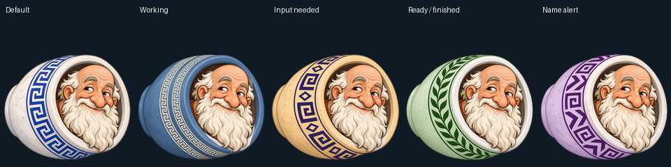

# Desk Buddy

A Windows desktop companion with visible timers, persistent alerts and an
expressive pet. Built with Python and Tkinter, with no third-party runtime
packages or API keys.

This is a desktop prototype for a future **ESP32-S3-LCD-1.3 prism** companion.
The timer works now. AI activity and name-call alerts are labeled simulations;
live ChatGPT/Codex events, microphone recognition and hardware output are planned.

Inspired by [Joe Bentham's desk-buddy](https://github.com/joebentham/desk-buddy),
[MakerSteele's linear-clock-app](https://github.com/MakerSteele/linear-clock-app)
and [MakerSteele's name-alert](https://github.com/MakerSteele/name-alert).
See [credits and upstream licenses](ACKNOWLEDGEMENTS.md).



## Run

Install Python 3.10 or newer with Tkinter. On Windows, the standard Python
installer includes Tk support. From the repository folder:

```powershell
python -m deskbuddy
```

You can also double-click `Desk Buddy.pyw` when Python file associations are
configured, or run `run.ps1`. Tested on Windows with Python 3.13 and Tk 8.6.

## What works

- Countdown and count-up timers, a visible time bar, pause/resume and restart recovery.
- Persistent alerts with priority: name call, AI input needed, timer finished, reply ready.
- Two simulated AI sessions, unread reply counts and input/interrupt states.
- A movable, always-on-top floating view; open it with **Ctrl+M**.
- Keyboard controls: **F1** name test, **F2** working, **F3** approval, **F4** ready reply.
- Diogenes V2, with an animated white/cobalt default and four static status pot designs.
- Reduced motion by default; gentle animation is opt-in.
- Local timer/settings persistence in `.local/state.json`.

Try **10 sec test**, then **Approval**, then **Test name alert**. Acknowledging
an alert reveals the next queued notice. Dismissing an input notice never grants
permission or sends an answer to an AI client.

Use the original robot with `python -m deskbuddy --default-buddy`, or load your
own exported PNG with `--pet-sheet path/to/pet.png`. Pet-library synchronization
is manual. See [pet loading](docs/PETS.md) and [Diogenes artwork](assets/pets/diogenes/README.md).

## Development status

There is no live AI adapter, microphone capture, network listener, serial
connection, tray icon or startup service in this version. Hardware is not yet
available, and no prism firmware or physical-device support has been verified.

The next steps are a verified Codex/ChatGPT Work event adapter, opt-in local name
recognition, and USB output to the prism. Read the [prototype guide](docs/PROTOTYPE.md)
for behavior and limits, and [research and implementation direction](docs/RESEARCH.md)
for the upstream references and integration questions.

## Verify

```powershell
python -m unittest discover -s tests -v
python -m deskbuddy --smoke-test
```

The smoke check renders both windows with temporary state and exits. Tests cover
timers, persistence, alert ordering, acknowledgement isolation, simulated session
transitions and sprite loading. Screen-reader behavior, mixed-DPI monitor movement,
actual OS sleep/wake and physical hardware still need testing.

## Credits and licenses

This is an independent implementation, with original Python/Tkinter code and no
copied upstream code or Lump artwork. The source code and documentation use the
[MIT license](LICENSE). Bundled Diogenes images have a separate
[artwork license](assets/pets/diogenes/LICENSE-ART.md).

Credit for the projects that inspired the companion, time-management and
accessibility features belongs to Joe Bentham and Steven Steele (MakerSteele).
Their projects and license boundaries are documented in
[ACKNOWLEDGEMENTS.md](ACKNOWLEDGEMENTS.md).
