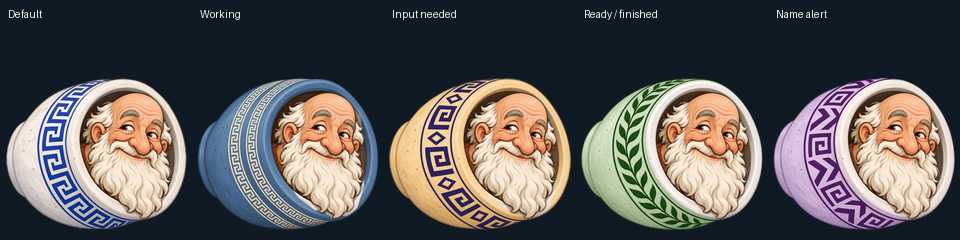

# Diogenes

Diogenes is an existing custom pet redesigned for this project with AI image
generation, compositing and sprite assembly. He keeps his sideways pithos and
character, with a white pot, cobalt Greek key and a less yellow complexion.

The default uses an animated V2 sheet. The four desktop status treatments are
static cells: blue/ivory keys for working, amber/indigo diamonds for input needed,
green laurel for ready/finished, and violet chevrons/spirals for a name alert.
The resting face is preserved across the status treatments. Text and badges
identify the status as well as the pot design.

`appearance.json` contains only relative asset paths. It has no account ID, pet
record ID or private Library URL. The app does not update or synchronize a remote pet.

## Published export and checks

- `spritesheet.png`: 1536 by 2288 RGBA, 192 by 208 cells, eight columns.
- Nine animation states (57 populated cells) plus sixteen look directions.
- SHA-256: `4b5439b3ad72bef599cfbdff6b7a04741fc601df2f372d02e1f4bbd88919fa2d`.
- The final sheet passed the bundled Pets V2 geometry/quality checks, visual
  review and an independent direction review during production. Two subtle
  intermediate looks were accepted after review.
- The desktop reader uses the activity rows; it does not use look directions yet.
- The desktop prototype was checked with this sheet and all four skins in the
  main and floating windows at 250% Windows display scaling.

Original exports, production intermediates, Library archives and private pet
records remain outside the published Git files. Physical prism playback has not
been tested. The full animated pet and the desktop status skins are separate
assets; this is not an animated set of all four pot treatments.

See [pet loading and role mapping](../../../docs/PETS.md) and the separate
[artwork license](LICENSE-ART.md).
